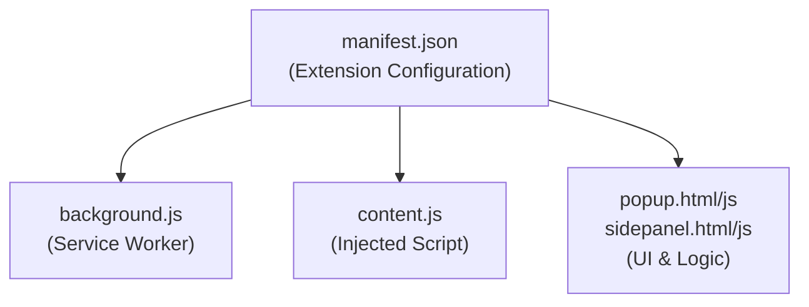
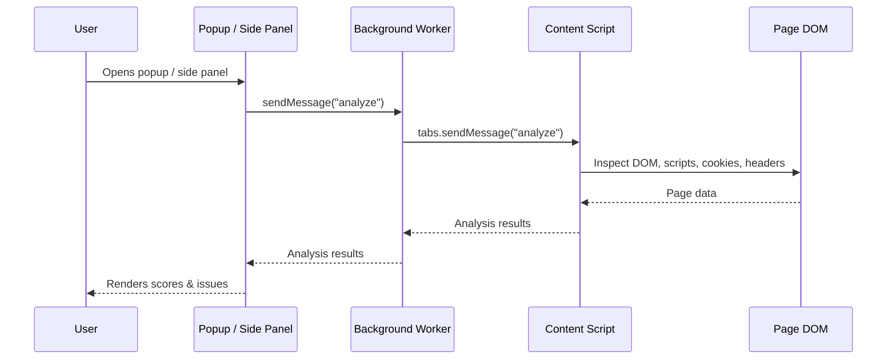

# WebAudit - Web Security & Code Inspector

<p align="center">
  
  
  
  
  
</p>

## Table of Contents

1. [Overview](#overview)
2. [Features](#features)
3. [Installation](#installation)
4. [Usage](#usage)
5. [Technical Architecture](#technical-architecture)
6. [Scoring System](#scoring-system)
7. [Security Checks Explained](#security-checks-explained)
8. [Project Structure](#project-structure)
9. [Permissions & Privacy](#permissions--privacy)
10. [Contributing](#contributing)
11. [License](#license)

---

## Overview

WebAudit is a lightweight Chrome/Edge extension that performs real-time structural, security, and developer analysis of any webpage, presenting clear scores with actionable insights. It's designed to help:

- **Beginner web developers** learn best practices
- **Cybersecurity students** understand common vulnerabilities
- **Bug bounty hunters** quickly assess a target page
- **QA engineers** perform quick audits
- **Webmasters** check site health

### Why WebAudit?

Security, accessibility, and performance are often overlooked in day-to-day web development. WebAudit gives instant feedback on:
- HTML structure quality
- Security vulnerabilities (CSP, SRI, XSS, cookies)
- Accessibility best practices (ARIA, labels)
- Performance patterns (lazy loading, render blocking)

All analysis runs locally in the browser — nothing is sent to a server.

---

## Features

### Structure Analysis (DOM Inspection)

| Feature | Description |
|---------|-------------|
| Form Counter | Counts all `<form>` elements on the page |
| Input Field Counter | Counts all `<input>` elements |
| Script Counter | Counts total script tags (inline + external) |
| External CSS Counter | Counts external stylesheet links |
| Image Alt Checker | Detects images missing `alt` attributes |
| Meta Description | Checks for presence of meta description |
| Viewport Tag | Checks for responsive design viewport tag |
| Deprecated Tags | Detects obsolete HTML tags (center, font, etc.) |

### Security Checks (OWASP-Inspired)

| Check | Risk Level | Description |
|-------|------------|-------------|
| HTTPS Detection | High | Verifies the page uses a secure protocol |
| CSP Detection | High | Checks for a Content-Security-Policy header |
| SRI Check | Medium | Verifies Subresource Integrity on scripts |
| DOM XSS Sinks | High | Detects `eval()`, `document.write`, `innerHTML` usage |
| Cookie Security | Medium | Checks for Secure, HttpOnly, SameSite attributes |
| X-Frame-Options | Medium | Clickjacking protection check |
| Referrer Policy | Low | Controls information leakage |
| Inline Script Detection | Medium | Finds inline `<script>` tags (XSS risk) |
| Form CSRF Protection | High | Checks forms for CSRF tokens |
| Mixed Content | High | Detects HTTP resources loaded on HTTPS pages |
| JWT in localStorage | High | Flags JWTs stored in `localStorage` (XSS-exposed) |
| Exposed API Keys/Tokens | High | Regex scan for common key/secret patterns |

### Developer Metrics

| Check | Description |
|-------|-------------|
| Resource Counting | Images, CSS, JS, fonts, video, audio |
| Render Blocking | Detects blocking CSS/JS in `<head>` |
| Lazy Loading | Checks for `loading="lazy"` on images |
| Accessibility | ARIA labels, input labels, semantic roles |
| Deprecated Tags | Detects obsolete HTML elements |

### Risk Scoring System

The extension calculates four scores:

1. **Structure Score (0-100)** — based on HTML best practices
2. **Security Score (0-100)** — based on security vulnerabilities
3. **Developer Score (0-100)** — based on performance/accessibility best practices
4. **Overall Score (0-100)** — weighted average: Security 50%, Structure 25%, Developer 25%

#### Risk Categories

| Score Range | Category | Action Required |
|-------------|----------|-----------------|
| 80-100 | Safe | None |
| 60-79 | Needs Attention | Review issues |
| 0-59 | High Risk | Urgent attention |

### UI Features

- **Popup view** and a **side panel view**, both backed by the same analysis
- **Dark mode** (default) and **light mode**, toggled from the header, with the preference persisted in `localStorage`
- Circular score gauge with color-coded risk level
- Issue list, color-coded by severity

---

## Installation

### Prerequisites

- Google Chrome (version 88+), or any Chromium-based browser (Edge, Brave, etc.)

### Manual Installation

1. **Clone the repository**
   ```bash
   git clone https://github.com/kasmya/WebAudit.git
   cd WebAudit
   ```

2. Navigate to `chrome://extensions` in your browser's address bar.
3. Enable **Developer mode** (top-right toggle).
4. Click **Load unpacked** and select the `WebAudit` folder.
5. Pin the extension via the puzzle-piece icon in the toolbar for quick access.

### Verify Installation

- The WebAudit icon should appear in your toolbar.
- Click it to open the popup, or open the side panel, to see the UI.

---

## Usage

1. Navigate to any webpage you want to analyze.
2. Click the WebAudit extension icon (or open its side panel).
3. The extension scans the current page automatically.
4. Review the results:
   - Overall score (weighted)
   - Structure, Security, and Developer breakdowns
   - List of detected issues, with severity and description

Click the moon/sun icon in the header to toggle dark/light mode; the choice persists across sessions.

---

## Technical Architecture

### Manifest V3



### File Descriptions

| File | Purpose |
|------|---------|
| `manifest.json` | Extension configuration, permissions, metadata |
| `src/background.js` | Service worker, handles message passing |
| `src/content.js` | Injected script, performs the DOM/security analysis |
| `src/popup.html` / `src/popup.js` | Popup UI and logic (theme management, result display) |
| `src/sidepanel.html` / `src/sidepanel.js` | Side panel UI, an alternative to the popup |
| `scripts/convert-icons.js` | One-off dev script: renders `assets/icon.svg` into the PNG sizes under `assets/icons/` |

### Communication Flow



1. The user opens the popup or side panel.
2. It sends a message to the background service worker.
3. The background worker relays it to the content script.
4. The content script analyzes the DOM and returns results.
5. Results flow back and are rendered in the UI.

---

## Scoring System

### Structure Score

```
Base Score: 100

Deductions:
├── Images without alt (each): -5
├── Inline scripts (each):     -3
├── Missing meta description:  -10
└── Missing viewport tag:      -5

Final Score = clamp(Base - Deductions, 0, 100)
```

### Security Score

```
Base Score: 100

Deductions:
├── No HTTPS:                 -30
├── JWT in localStorage:      -25
├── API keys found:           -20
├── Excessive scripts (>10):  -15
├── Inline scripts (each):    -2
└── Exposed tokens:           -15

Final Score = clamp(Base - Deductions, 0, 100)
```

### Overall Score

```
Overall = round(Security * 0.50 + Structure * 0.25 + Developer * 0.25)
```

---

## Security Checks Explained

### HTTPS Detection
Checks whether the page is served over `https://`. Without it, traffic can be intercepted or tampered with in transit.

### Inline Script Detection
Flags `<script>` tags without a `src` attribute — a common XSS vector. External files with CSP/SRI are recommended.

### JWT in localStorage
Scans `localStorage` for JWT-shaped values. `localStorage` is readable by any script on the page, so it's exposed to XSS; prefer httpOnly cookies for session tokens.

### API Key / Secret Patterns
Regex search for common key/secret patterns (`api_key`, `apikey`, `secret`, `password`, `token`, `bearer`, etc.) in page source and inline attributes. Exposed credentials can be scraped and reused.

### Excessive Scripts
Flags pages loading more than 10 external scripts — a signal for supply-chain risk and performance overhead.

### Exposed Tokens
Searches HTML attributes for long opaque strings that look like access tokens, which can be scraped from the page source.

---

## Project Structure

```
WebAudit/
├── manifest.json                   # MV3 configuration
├── src/
│   ├── background.js                # Service worker
│   ├── content.js                   # DOM/security analyzer
│   ├── popup.html / popup.js        # Popup UI + logic
│   └── sidepanel.html / sidepanel.js  # Side panel UI + logic
├── assets/
│   ├── icon.svg                      # Source icon
│   └── icons/                        # Generated PNG icons (16/48/128)
├── scripts/
│   └── convert-icons.js              # Dev script: SVG -> PNG icons
├── test-pages/
│   ├── test-page.html                # Test page (moderate risk)
│   └── test-page-high-risk.html      # Test page (high risk)
├── PRIVACY_POLICY.md                # Privacy policy
└── README.md                        # Documentation
```

### Test Pages

| File | Purpose |
|------|---------|
| `test-pages/test-page.html` | Page with a moderate number of issues |
| `test-pages/test-page-high-risk.html` | Page with multiple deliberate security issues |

Load either file in the browser and run WebAudit against it to sanity-check the scoring logic after making changes.

---

## Permissions & Privacy

### Required Permissions

| Permission | Purpose |
|------------|---------|
| `activeTab` | Access the current tab's information |
| `scripting` | Execute the content script |
| `host_permissions: http(s)://*/*` | Analyze any webpage |

### Privacy

- No data is collected.
- No external network calls — all analysis runs client-side.
- No backend — works fully offline after installation.

See [PRIVACY_POLICY.md](PRIVACY_POLICY.md) for the full policy.

---

## Contributing

1. Fork the repository.
2. Create a feature branch: `git checkout -b feature/your-feature`
3. Make your changes and test locally:
   - Go to `chrome://extensions`
   - Click **Reload** on WebAudit
   - Verify against `test-pages/test-page.html` and `test-pages/test-page-high-risk.html`
4. Commit and push your branch.
5. Open a Pull Request.

---

## License

This project is licensed under the MIT License — see [LICENSE](LICENSE) for details.

---

## Acknowledgments

- [OWASP](https://owasp.org/) — security guidelines and principles
- [Chrome Extensions Documentation](https://developer.chrome.com/docs/extensions/) — Manifest V3 reference

---

## Links

- [Report Issues / Request Features](https://github.com/kasmya/WebAudit/issues)
